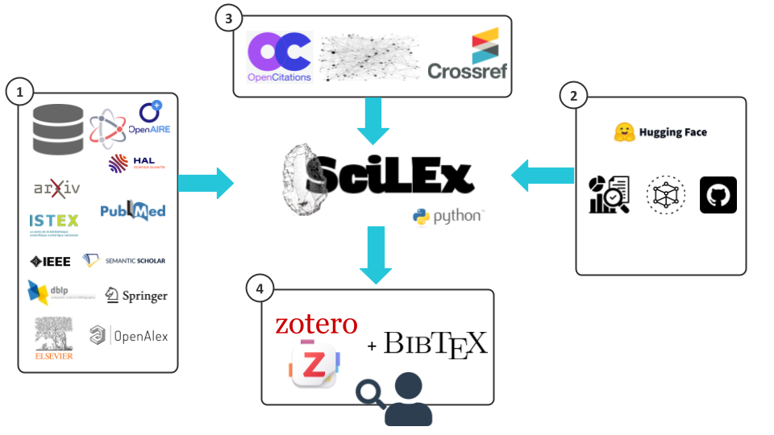
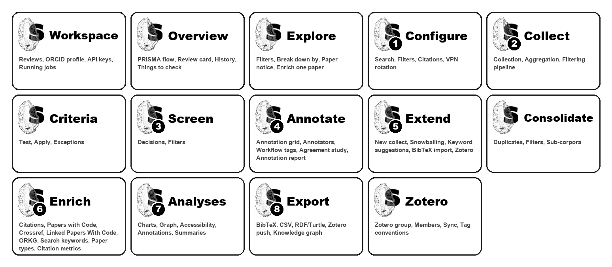

<div align="center">
<br>


</div>

<p align="center">
    <em>Systematic literature search across 14 academic APIs</em>
</p>

<p align="center">
    
    
    
    
</p>

<p align="center">
    <a href="https://scilex.readthedocs.io/en/latest/">
    
    </a>
    
    <a href="https://joss.theoj.org/papers/9fc1db5f4db530c036dd7744e2147b2d"></a>
</p>

---
> SciLEx — like the silex stone that early humans relied on to spark fire from raw material — is a lightweight, portable tool designed to ignite research exploration. Rather than navigating fragmented databases, confronting redundant results, and manually sifting through noise, SciLEx strikes directly at the core challenge: it queries heterogeneous digital library APIs, applies smart deduplication and quality filtering, and delivers a clean, curated corpus. It then carries the review on — screening, collaborative annotation in Zotero, enrichment, analyses — up to a knowledge graph that others can query and reuse.

## Table of Contents

- [Overview](#overview)
- [Architecture](#architecture)
- [Modules](#modules)
- [Key Features](#key-features)
- [Project Structure](#project-structure)
- [Getting Started](#getting-started)
- [Related Projects](#related-projects)
- [Where SciLEx Is Used](#where-scilex-is-used)
- [Citation](#citation)
- [Contributing](#contributing)
- [License](#license)

---

## Overview

**SciLEx** (Science Literature Exploration) is a Python toolkit for systematic literature reviews. It crawls 14 academic APIs in parallel, deduplicates results using DOI-based and normalized title exact matching, and applies a 5-phase quality filtering pipeline. It then carries the review through eligibility criteria, screening, collaborative annotation in a Zotero group, corpus extension, enrichment from open scholarly sources and analyses, up to an export to Zotero, BibTeX, RDF/Turtle or a knowledge graph conforming to the [scilex-lpwc-ap](https://codeberg.org/cringwald/scilex-lpwc-ap) application profile.
It runs from the command line or from a desktop app (macOS, Windows, Linux) that works on the same review folders.


---

## Architecture



---

## Modules

Each step of a review is a module (a screen of the desktop app, and for most a `scilex-*` command), presented with the flint of the SciLEx icon. See [Modules at a glance](https://scilex.readthedocs.io/en/latest/modules/index.html).

<p align="center">
  
</p>

| Module | Purpose |
|---|---|
| Workspace | reviews, ORCID iD (required), global API keys, running jobs |
| Overview | PRISMA flow, provenance card, history, things to check |
| Explore | filter the corpus, break it down, read each paper's notice |
| ① Configure | `scilex.yml`: search, filters, citations, VPN rotation |
| ② Collect | 14 APIs, deduplication, 5-phase filtering, ranking |
| Eligibility criteria | the SLR criteria table as testable, reversible rules |
| ③ Screen | include / exclude / maybe, with keyboard shortcuts |
| ④ Annotate | annotation grid in Zotero, annotators, agreement study (Krippendorff's alpha) |
| ⑤ Extend | new collect, snowballing, keyword suggestions, BibTeX, Zotero — one Zotero collection per extension |
| Consolidate | cross-source duplicates, filters, required sub-corpora |
| ⑥ Enrich | citations, Papers with Code, Crossref, Linked Papers With Code, ORKG, search keywords, paper types, citation metrics |
| ⑦ Analyses | charts, citation graph, accessibility, annotations, summaries — compared by paper type or collection |
| ⑧ Export | BibTeX, CSV, RDF/Turtle, Zotero, knowledge graph (SHACL-checked) |
| Zotero | one group per review, members, two-way sync, tag conventions |

---

## Key Features

- Multi-API collection with parallel processing (14 academic APIs)
- Smart deduplication using DOI and normalized title matching
- 5-phase quality filtering pipeline with time-aware citation thresholds:
  1. **ItemType Filter** — whitelist by publication type (journal, conference, etc.)
  2. **Quality Filter** — require DOI, abstract, year, minimum author count, optional open-access
  3. **Abstract Quality Filter** — remove placeholder or low-quality abstracts
  4. **Citation Filter** — time-aware thresholds (e.g. ≥1 citation after 18 months, ≥10 after 3 years)
  5. **Relevance Ranking** — composite score (0–10) from keyword density, metadata completeness, venue type, and citation impact
- Citation count enrichment via CrossRef, OpenCitations, OpenAlex and Semantic Scholar
- Optional CORE/SJR venue ranking, open-access lookup (Unpaywall) and LLM relevance screening (OpenRouter)
- Papers with Code enrichment: tasks, methods, evaluated benchmarks, official GitHub repository and stars from [paperswithcode.co](https://paperswithcode.co) (anonymous API, no key)
- Crossref, Linked Papers With Code and ORKG enrichment; default paper types (Benchmark, Review, Dataset, Model); citation metrics (PageRank, citations per year…)
- Eligibility criteria (period, coherence, language, access, peer review, DOI, duplicates) as testable rules with exceptions
- Collaborative annotation in a dedicated Zotero group: annotation grid, balanced assignment, inter-annotator agreement, two-way sync of tags
- LLM pre-annotation through the [SciLEx Annotator](https://github.com/datalogism/SciLex-LmmAnnotator) prototype: models write `DIMENSION-AUTO:value` proposals that a person accepts, corrects or rejects (human first)
- Analyses: citation graphs and communities, accessibility and coverage, annotation crossings, cluster summaries, snowball sampling, seed papers, keyword suggestions
- Export to Zotero (bulk upload), BibTeX (with PDF links), RDF/Turtle, or a knowledge graph with the scilex-lpwc-ap application profile
- Traceability: PRISMA flow, append-only workflow journal (agent = ORCID iD), per-paper import log
- Desktop app: the whole review without the command line
- Idempotent, resumable collections (`--resume`, incremental `--since`)

### Supported APIs

| API | Key Required | Coverage | Best For |
|-----|-------------|----------|----------|
| **SemanticScholar** | Optional | 200M+ papers | CS/AI papers, citation networks |
| **OpenAlex** | Optional | 250M+ works | Broad coverage, ORCID data |
| **IEEE** | Yes | 5M+ docs | Engineering, CS conferences |
| **Arxiv** | No | 2M+ preprints | Preprints, physics, CS |
| **BioRxiv** | No | ~50k preprints/year | Biology preprints (bioRxiv only; no server-side search, so a yearly cache is filtered client-side) |
| **Springer** | Yes | 13M+ docs | Journals, books |
| **Elsevier** | Yes | 18M+ articles | Medical, life sciences |
| **PubMed** | Optional | 35M+ papers | Biomedical literature |
| **PubMedCentral** | Optional | 10M+ full texts | Open-access biomedical full text |
| **HAL** | No | 1M+ docs | French research, theses |
| **DBLP** | No | 6M+ CS papers | CS bibliography, 95%+ DOI |
| **Istex** | No | 25M+ docs | French institutional access |
| **OpenAIRE** | No | 200M+ docs | Open-access, EU research |
| **ORKG** | No | 55K papers | Structured CS research comparisons |

See the [API Comparison](https://scilex.readthedocs.io/en/latest/reference/api-comparison.html) for rate limits, coverage details, and limitations.

---

## Project Structure

```sh
└── SciLEx/
    ├── README.md
    ├── pyproject.toml
    ├── CONTRIBUTING.md
    ├── scilex.yml.example
    ├── keys.yml.example
    ├── scilex/
    │   ├── run_collection.py, aggregate_collect.py, collect_status.py   # CLI entry points
    │   ├── enrich_with_*.py, linked_enrichment.py, paper_types.py      # enrichment
    │   ├── push_to_zotero.py, export_to_*.py, build_kg.py               # outputs
    │   ├── settings/        # scilex.yml / keys.yml schema, presets, loader, migration
    │   ├── templates/       # scilex init templates
    │   ├── pipeline/        # aggregation, filtering, ranking, reports
    │   ├── crawlers/        # one collector per API
    │   ├── citations/       # citation resolution and cache
    │   ├── rdf/             # RDF/Turtle export
    │   ├── kg/              # knowledge graph (pinned scilex-lpwc-ap profile in kg/ap/)
    │   ├── graph_analysis/, snowball/, summarize/, keyword_suggestions/
    │   ├── gui/             # desktop app (scilex-gui): pages/, services/, components/
    │   ├── Zotero/
    │   └── PapersWithCode/
    ├── tests/
    ├── docs/
    └── img/
```

---

## Getting Started

### Prerequisites

- 
- [uv](https://docs.astral.sh/uv/) (recommended) or pip

### Installation

1. Clone the repository:

```sh
❯ git clone https://github.com/Wimmics/SciLEx
```

2. Navigate to the project directory:

```sh
❯ cd SciLEx
```

3. Install dependencies:

**Using `uv`** &nbsp; []

```sh
❯ uv sync
```

**Using `pip`:**

```sh
❯ pip install -e .

# With dev dependencies (pytest, ruff, coverage)
❯ pip install -e ".[dev]"
```

The desktop app needs the `gui` extra: `uv sync --extra gui` (or `pip install -e ".[gui]"`).

### Configuration

SciLEx uses two files:

- `scilex.yml`: one per review, in your working folder (search terms, years, APIs, filters).
- `keys.yml`: your API keys, shared by all reviews, in `~/.config/scilex/keys.yml`.

```sh
❯ mkdir my-review && cd my-review
❯ scilex init                                   # writes ./scilex.yml (or: scilex-init --template computer-science)
❯ mkdir -p ~/.config/scilex
❯ cp /path/to/SciLEx/keys.yml.example ~/.config/scilex/keys.yml   # then add your keys
❯ scilex config check                           # validate both files without running anything
```

`scilex.yml.example` lists every option with its default; you only write what differs from the defaults.
Typos are reported with a suggestion (`filters.max_paper: unknown key. Did you mean ranking.max_papers?`).
Use `scilex config show` to see the effective values and where each one comes from.

See the [Configuration Reference](https://scilex.readthedocs.io/en/latest/reference/configuration.html) for all settings.

#### Migrating from the old format

Older versions used `scilex/scilex.config.yml`, `scilex/scilex.advanced.yml` and `scilex/api.config.yml`.
They are still read (with a warning) but are deprecated. Convert them with:

```sh
❯ scilex config migrate                  # print the equivalent scilex.yml
❯ scilex config migrate --write          # write ./scilex.yml (add --force to overwrite)
❯ scilex config migrate --from DIR       # read the old files from DIR instead of the package
```

Move your API keys from `scilex/api.config.yml` to `~/.config/scilex/keys.yml` (same structure).

### Usage

**Option A — with environment activation:**
```sh
❯ source .venv/bin/activate       # macOS/Linux
❯ .venv\Scripts\activate          # Windows
❯ scilex-collect          # run from the folder that contains scilex.yml
```

**Option B — with `uv run` (no activation needed):**
```sh
❯ uv run scilex-collect
```

Run the pipeline step by step:

```sh
# 0. Validate the configuration
❯ scilex config check

# 1. Collect papers from all configured APIs
❯ scilex-collect                # --resume NAME to continue a run, --since YYYY-MM-DD for incremental
❯ python -m scilex status       # collection completeness (keywords, APIs, years)

# 2. Deduplicate, filter and rank
❯ scilex-aggregate              # --skip-citations to skip citation lookups, --workers N
❯ scilex-aggregate --collection NAME --use-current-config   # replay on an existing (even partial) collection with the current scilex.yml

# 3. (Optional) Enrich with Papers with Code metadata
❯ scilex-enrich

# 4. Export results
❯ scilex-push-zotero        # Push to a Zotero collection
❯ scilex-export-bibtex      # Export to BibTeX
❯ scilex-export-turtle      # Export to RDF/Turtle
❯ scilex-build-kg           # Knowledge graph (scilex-lpwc-ap profile, SHACL-checked)
```

Every pipeline command accepts `--config PATH` and `--keys PATH`.
`python -m scilex <collect|aggregate|status|enrich|export-bibtex|push-zotero|init|config>` is the equivalent module entry point.

Other commands:

```sh
❯ scilex-enrich-citations   # add citation counts to an existing aggregated file
❯ scilex-report             # charts / report from aggregated results
❯ scilex-analyze            # graph analysis (co-authorship, communities)
❯ scilex-snowball           # snowball sampling (references / citing papers)
❯ scilex-seed               # start from seed papers (DOIs, BibTeX)
❯ scilex-summarize          # cluster summaries
❯ scilex-suggest-keywords   # keyword suggestions from a first collection
```

See the [Quick Start Guide](https://scilex.readthedocs.io/en/latest/getting-started/quick-start.html) for a complete walkthrough.

**Option C — 🖥️ Desktop app**

Ready-to-run builds for macOS (`.dmg`), Windows (`.zip`) and Linux (`.tar.gz`) are attached to each
[GitHub Release](https://github.com/Wimmics/SciLEx/releases/latest) (the macOS app is not signed yet:
right-click → **Open** the first time). The app asks for your ORCID iD first; API keys (including one global Zotero key) are set once for all reviews, and each review gets its own Zotero group.
A review goes through Overview, Explore, ① Configure, ② Collect, Eligibility criteria, ③ Screen, ④ Annotate, ⑤ Extend, Consolidate, ⑥ Enrich, ⑦ Analyses and ⑧ Export; it can also start from an existing Zotero library or a SciLEx knowledge graph.

From a checkout:
```sh
❯ uv sync --extra gui
❯ uv run scilex-gui              # native window
❯ uv run scilex-gui --browser    # same UI in a browser tab (--port N, --no-open)
❯ uv run scilex-gui --self-test  # check the installation without opening a window
❯ scripts/build_gui.sh           # build a standalone app with PyInstaller (dist/), then self-test it
```
See the [desktop app guide](docs/user-guides/gui.md) and the [module pages](docs/modules/index.md).

### Testing

Install dev dependencies first (not included in the default install):

```sh
❯ uv sync --extra dev
```

Then run the tests:

```sh
❯ uv run python -m pytest tests/ -v                                              # All tests
❯ uv run python -m pytest tests/ --cov=scilex --cov-report=term-missing         # With coverage
❯ uv run python -m pytest tests/ -v -m "not live"                               # Offline tests only
```

---


## Related Projects

| Project | Role | Status |
|---|---|---|
| **[scilex-lpwc-ap](https://codeberg.org/cringwald/scilex-lpwc-ap)** (Codeberg) | Application profile of the SciLEx knowledge graph. It builds on [Linked Papers With Code](https://linkedpaperswithcode.com) and reuses SPAR (FaBiO, CiTO, PRO), BIBO, PROV-O, DCAT and VoID. Each iteration ships RML mappings, SPARQL rules, SHACL shapes and competency questions. SciLEx pins a copy in `scilex/kg/ap/` (refresh with `python -m scilex.kg.sync_profile`), runs it in ⑧ Export → Knowledge graph / `scilex-build-kg`, and checks the result with its shapes. | Iteration 8 (0.8.0), pre-release |
| **[SciLEx Annotator](https://github.com/datalogism/SciLex-LmmAnnotator)** (GitHub) | LLM-assisted annotation of a SciLEx collection. For each paper it reads the full text, asks one question per grid dimension, and checks that each answer has values, verbatim evidence and a confidence level. It runs as a web app, a command line, or an HTTP service that ④ Annotate → Campaigns calls (`scilex-annotator api --port 8001`). Hosted LLMs, Ollama models and GLiNER2 decision models. | Prototype |

---

## Where SciLEx Is Used

### Projects

| Project | Use of SciLEx |
|---|---|
| **Infinity project** | work packages WP8.6 *Workflow ecosystem lifecycle* and WP8.4 *AI tools* |
| **[GOBLIN](https://cringwald.codeberg.page/GOBLIN-WG1.1/)** — COST Action CA23147 *Global Network on Large-Scale, Cross-domain and Multilingual Open Knowledge Graphs*, WG1 *Knowledge Graphs Engineering* | The WG1.1 community survey *Methodologies, tools and practices for KG modelling* collects, screens and annotates its literature with SciLEx (shared Zotero group `goblin-wg1.1_survey`) |

### Articles

- C. Ringwald, F. Gandon, C. Faron, F. Michel, H. Abi Akl. **A systematic review of relation extraction task since the emergence of Transformers.** arXiv:2511.03610, 2025 (submitted to ACM Computing Surveys). [arXiv](https://arxiv.org/abs/2511.03610) · [annotated Zotero bibliography](https://www.zotero.org/groups/6070963/scilex_re_systlitreview)
- N.-E. Mbengue. **In Data or Invisible: Toward a Better Digital Representation of Low-Resource Languages with Knowledge Graphs.** PhD proposal, ESWC 2026, Dubrovnik. [arXiv:2605.05931](https://arxiv.org/pdf/2605.05931)
- G. Montenegro. **Towards Ontology-Guided and Traceable GraphRAG for Legal Knowledge in Industrial Maintenance.** ISWC 2026. [HAL hal-05775660](https://inria.hal.science/hal-05775660v1/document)
- B. Navet. **Knowledge Graphs as External Memory for LLM-based Scientific Assistants.** ISWC 2026. [HAL hal-05747244](https://hal.science/hal-05747244v1/document)

Using SciLEx in a project or a paper? Open an [issue](https://github.com/Wimmics/SciLEx/issues) or a pull request to add it here.

---

## Citation

If you use SciLEx in your research, please cite:

**Full text:**

Célian Ringwald, Benjamin Navet, Yousouf Taghzouti, Fabien Gandon. SciLEx, Science Literature Exploration Toolkit ⟨swh:1:dir:944639eb0260a034a5cbf8766d5ee9b74ca85330⟩.

**BibTeX:**

```bibtex
@softwareversion{scilex2026,
  TITLE = {{SciLEx, Science Literature Exploration Toolkit}},
  AUTHOR = {Ringwald, Célian and Navet, Benjamin and Taghzouti, Yousouf and Gandon, Fabien},
  URL = {https://github.com/Wimmics/SciLEx},
  NOTE = {},
  INSTITUTION = {{University Côte d'Azur ; CNRS ; Inria}},
  YEAR = {2026},
  MONTH = Fev,
  SWHID = {swh:1:dir:944639eb0260a034a5cbf8766d5ee9b74ca85330},
  VERSION = {1.0},
  REPOSITORY = {https://github.com/Wimmics/SciLEx},
  LICENSE = {MIT Licence},
  KEYWORDS = {Python, Scientific literature, literature research, paper retrieval},
  HAL_ID = {},
  HAL_VERSION = {},
}
```

---

## Contributing

- Report issues: [GitHub Issues](https://github.com/Wimmics/SciLEx/issues)
- See [CONTRIBUTING.md](CONTRIBUTING.md) for development guidelines

<p align="center">
   <a href="https://github.com/Wimmics/SciLEx/graphs/contributors">
      
   </a>
</p>

---

## License

This project is protected under the [MIT](LICENSE) License. For more details, refer to the [LICENSE](LICENSE) file.

---

<p align="center">
   <a href="#top">Return to top</a>
</p>
