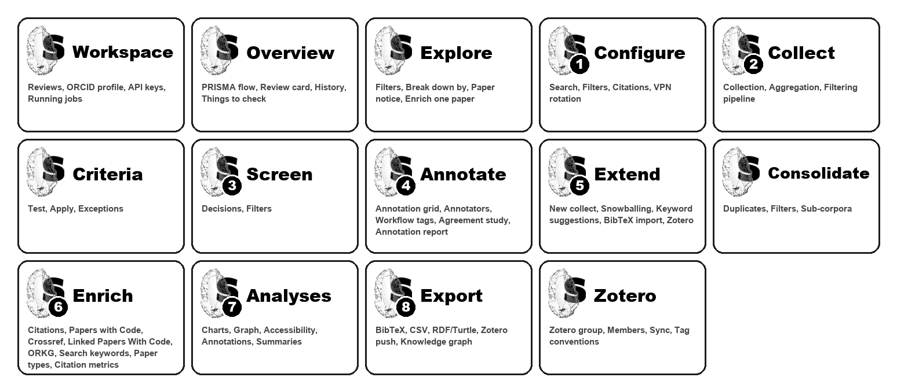

# SciLEx Documentation


**SciLEx** (Science Literature Exploration) is a toolkit for systematic literature
reviews. It collects papers from 14 academic APIs, deduplicates and filters them, then
carries the review through eligibility criteria, screening, collaborative annotation in
Zotero, corpus extension, enrichment from open scholarly sources, analyses, and export
to BibTeX, Zotero or a knowledge graph conforming to the
[scilex-lpwc-ap](https://codeberg.org/cringwald/scilex-lpwc-ap) application profile.

It runs from the command line (`scilex-*` commands) or from a desktop app (macOS,
Windows, Linux) that works on the same review folders.

## Modules

Each step of a review is a module, presented with the flint of the SciLEx icon. Click a
module to open its page.

<a href="modules/index.html"></a>

| | | |
|---|---|---|
| <a href="modules/workspace.html"></a> | <a href="modules/overview.html"></a> | <a href="modules/explore.html"></a> |
| <a href="modules/configure.html"></a> | <a href="modules/collect.html"></a> | <a href="modules/criteria.html"></a> |
| <a href="modules/screen.html"></a> | <a href="modules/annotate.html"></a> | <a href="modules/extend.html"></a> |
| <a href="modules/consolidate.html"></a> | <a href="modules/enrich.html"></a> | <a href="modules/analyses.html"></a> |
| <a href="modules/export.html"></a> | <a href="modules/zotero.html"></a> | |

```{toctree}
:maxdepth: 2
:caption: Getting Started

getting-started/installation
getting-started/quick-start
getting-started/configuration
getting-started/troubleshooting
```

```{toctree}
:maxdepth: 2
:caption: Modules

modules/index
modules/workspace
modules/overview
modules/explore
modules/configure
modules/collect
modules/criteria
modules/screen
modules/annotate
modules/extend
modules/consolidate
modules/enrich
modules/analyses
modules/export
modules/zotero
```

```{toctree}
:maxdepth: 2
:caption: User Guides

user-guides/gui
user-guides/basic-workflow
user-guides/advanced-filtering
user-guides/python-scripting
```

```{toctree}
:maxdepth: 2
:caption: Reference

reference/cli
reference/configuration
reference/tags
reference/review-files
reference/api-comparison
reference/bibtex-export
```

```{toctree}
:maxdepth: 2
:caption: Developer Guides

developer-guides/architecture
developer-guides/adding-collectors
developer-guides/kg-apis-feasibility
kg/provenance-proposal
```

## Quick start

**Desktop app**: download it from the
[latest release](https://github.com/Wimmics/SciLEx/releases/latest), enter your ORCID
iD, set your API keys, then **New review**. See the
[desktop application guide](user-guides/gui.md).

**Command line**:

```bash
scilex init                 # write scilex.yml in the review folder
mkdir -p ~/.config/scilex && cp keys.yml.example ~/.config/scilex/keys.yml
scilex config check         # validate both files
scilex-collect              # query the APIs
scilex-aggregate            # deduplicate, filter, rank
scilex-enrich-citations     # optional enrichment
scilex-export-bibtex        # or scilex-push-zotero, scilex-build-kg
```

## Supported APIs

Semantic Scholar, OpenAlex, IEEE Xplore, arXiv, bioRxiv, Springer, Elsevier, PubMed,
PubMed Central, HAL, DBLP, ISTEX, OpenAIRE and ORKG (Google Scholar is deprecated). See
the [API comparison](reference/api-comparison.md).

## Enrichment sources

Semantic Scholar, Crossref and OpenCitations (citations), Papers with Code, Linked Papers
With Code, ORKG, Unpaywall (open access), CORE/SJR (venue ranks), OpenRouter (optional
LLM screening).

## System requirements

- Python 3.10+ (3.12 or 3.13 recommended); not needed for the desktop app builds
- [uv](https://docs.astral.sh/uv/) (recommended) or pip
- 4 GB RAM minimum, an Internet connection
