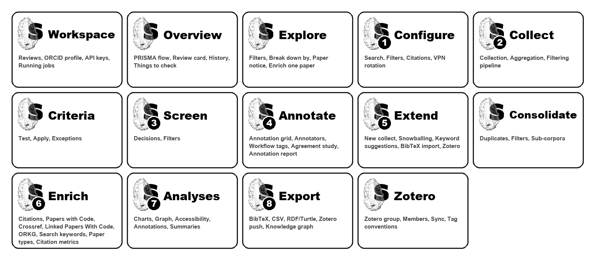

# Modules at a glance

SciLEx is organised in **modules**, one per step of a systematic literature review.
Each module is a screen of the desktop app (the numbers ① to ⑧ are the numbered
steps of its sidebar) and, for most of them, a `scilex-*` command. Every module is
presented with the SciLEx flint, the stone and its "S" from the application icon;
its sub-modules carry a lighter flint.



## The review workflow

```
                      ┌────────────── Workspace ──────────────┐
                      │ reviews · ORCID · API keys · jobs     │
                      └───────────────────┬───────────────────┘
                                          │ open a review
                                          ▼
   Overview ◄─────────── Explore (read-only, at any step) ──────────► paper notice
      │
      ▼
 ① Configure ──► ② Collect ──► Eligibility criteria ──► ③ Screen ──► ④ Annotate
                     ▲                                                   │
                     │  (once the review has papers)                     │
                     └──── ⑤ Extend ──► Consolidate ──► ⑥ Enrich ──► ⑦ Analyses ──► ⑧ Export
                                                                                     │
                       Zotero group · sync · tags  ◄─────────────────────────────────┘
```

A review can also start from an existing Zotero library, a SciLEx knowledge graph
or (as an extension) a BibTeX file: then ② Collect is skipped and the review opens
with papers. ⑥ Enrich can run before ③ Screen (on every paper) or after it (on the
papers kept).

## Modules

| Module | Purpose | Command line |
|---|---|---|
| <a href="workspace.html"></a> | Reviews, ORCID iD, API keys, running jobs | `scilex init`, `scilex config` |
| <a href="overview.html"></a> | State of a review: PRISMA flow, provenance, history | — |
| <a href="explore.html"></a> | Browse, filter and read every paper | — |
| <a href="configure.html"></a> | Edit `scilex.yml`: search, filters, citations, VPN | `scilex config check/show` |
| <a href="collect.html"></a> | Query 14 APIs, deduplicate, filter, rank | `scilex-collect`, `scilex-aggregate` |
| <a href="criteria.html"></a> | Eligibility criteria as testable rules | — |
| <a href="screen.html"></a> | Include / exclude / maybe decisions | — |
| <a href="annotate.html"></a> | Annotation grid, annotators, agreement | `python -m scilex.report_annotations` |
| <a href="extend.html"></a> | Add papers: new collect, snowballing, BibTeX, Zotero | `scilex-snowball`, `scilex-seed`, `scilex-suggest-keywords` |
| <a href="consolidate.html"></a> | Deduplicate and filter the extended corpus | — |
| <a href="enrich.html"></a> | Citations, PwC, Crossref, LPWC, ORKG, types, metrics | `scilex-enrich`, `scilex-enrich-citations` |
| <a href="analyses.html"></a> | Charts, citation graph, accessibility, annotations | `scilex-report`, `scilex-analyze`, `scilex-summarize` |
| <a href="export.html"></a> | BibTeX, CSV, Turtle, Zotero, knowledge graph | `scilex-export-bibtex`, `scilex-push-zotero`, `scilex-export-turtle`, `scilex-build-kg` |
| <a href="zotero.html"></a> | Group per review, members, two-way sync, tags | `scilex-push-zotero` |

The icons are drawn from the application icon by `docs/_tools/make_module_icons.py`;
run it again after adding or renaming a module.
