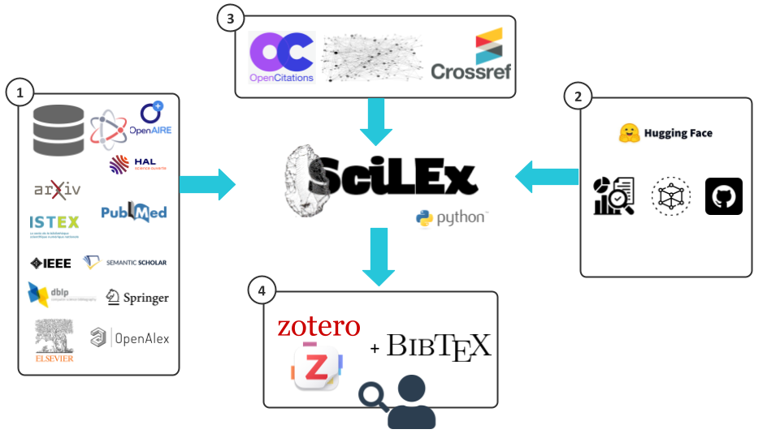
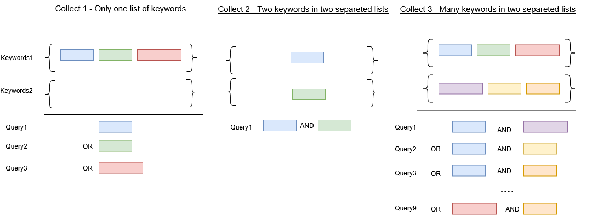
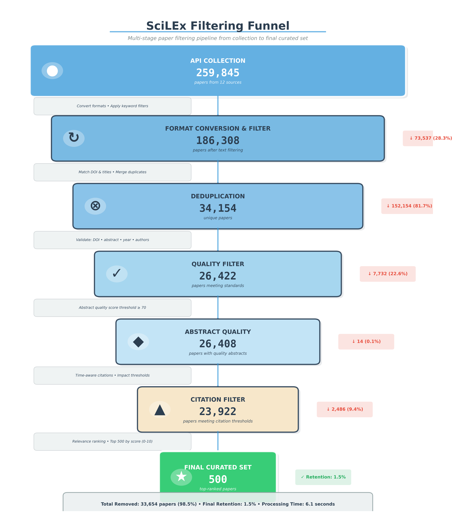

  

# SciLEx: a Spark for Systematic Literature Reviews

SciLEx takes its name from silex, the flint stone early humans struck to start a fire. It is a lightweight, locally executed tool that starts a literature review and carries it through. It queries heterogeneous digital library APIs, deduplicates and filters what they return, and delivers a curated corpus. It then supports screening and collaborative annotation of that corpus in Zotero, and exports the result to Zotero, BibTeX, or a knowledge graph that follows a published application profile.

{#scilex_overview}

# Summary

[SciLEx (Science Literature Exploration)](https://github.com/Wimmics/SciLEx) is an open-source Python toolkit for systematic literature reviews in research and academic contexts. Users define one or two groups of keywords: within each group, terms are combined with Boolean OR logic, while the two groups are combined with AND, enabling precise compound queries without manual query construction. As illustrated in [Fig.1](#scilex_overview), SciLEx concurrently queries up to fourteen academic APIs (Semantic Scholar, OpenAlex, IEEE, arXiv, bioRxiv, Springer, Elsevier, PubMed, PubMed Central, HAL, DBLP, ORKG, OpenAIRE and Istex) and deduplicates the results, so that a paper retrieved from several APIs becomes a single record. Collected papers then pass through a configurable multi-stage filtering pipeline that scores metadata completeness, enforces time-aware citation thresholds, and ranks results by a composite relevance score. This pipeline reduces hundreds of thousands of raw results to a curated set.

SciLEx extracts citation networks from Semantic Scholar, OpenAlex, CrossRef[@hendricks_crossref_2020] and OpenCitations[@peroni_opencitations_2020], and can enrich papers with Papers with Code, Linked Papers With Code[@farber_lpwc_2023] and ORKG metadata (tasks, methods, datasets, benchmarks and code repositories), which makes it particularly suited to AI and machine learning reviews. The rest of the review is also covered. Eligibility criteria are expressed as testable rules, screening decisions are recorded, and papers are annotated collaboratively in a dedicated Zotero[@mueen_ahmed_zotero_2011] group against an annotation grid, with an inter-annotator agreement study. LLM-generated proposals are optional and must be validated by a person. The corpus can be extended by snowballing, and the whole review is traced in a PRISMA-style flow. The final review can be exported to BibTeX, RDF/Turtle, a Zotero collection, or a knowledge graph that conforms to the **scilex-lpwc-ap** application profile[@scilex_lpwc_ap] and is checked with SHACL[@shacl_2017]. Every step is available from the command line and from a desktop application. All operations are idempotent: interrupted or repeated runs resume where they stopped, so SciLEx runs on standard personal hardware.

# Statement of Need

The volume of scientific publications has grown dramatically in recent years[@10.1162/qss_a_00327], making comprehensive literature surveys increasingly difficult to conduct manually. Researchers starting a new project or conducting a systematic review[@kitchenham2007guidelines] must navigate a fragmented landscape of disciplinary databases with incompatible formats, heterogeneous metadata standards, and varying access policies. Reference managers such as Zotero provide manual search interfaces and import functions. They do not automate multi-API retrieval, cross-source deduplication, or quality-based filtering. They also do not record the decisions of a review (criteria, screening, annotation codes and their agreement) in a form that can be published, queried and reused.

SciLEx fills this gap with a configurable, locally executed pipeline that requires no subscription and no cloud service. It takes keywords as input and produces a ranked, deduplicated and enriched bibliography, and it keeps Zotero as the collaborative workspace that research teams already use. It is designed for researchers and graduate students who need to scope a new research area efficiently, and for teams who want the outcome of their review, not only its bibliography, available as FAIR[@wilkinson_fair_2016] linked data.

# Key Features

SciLEx is built around the following core capabilities, each documented on [readthedocs.io](https://scilex.readthedocs.io/en/latest/):

* **Multi-source collection.** Papers are retrieved concurrently from up to fourteen academic APIs, with one thread per API to minimise collection time.
* **Flexible query construction.** Users can either supply a flat list of keywords, generating one query per keyword, or define two keyword groups whose terms are combined pairwise. This encodes OR logic within groups and AND logic across groups without raw query strings, as illustrated in [Appendix A](#appendix-a). Because the query is abstracted into mandatory and optional components, SciLEx adapts it to each API (e.g., PubMed, arXiv, HAL) whatever its native operators or field structure.
* **Cross-source deduplication.** Results are deduplicated across APIs using DOI matching, URL matching, and normalized exact title matching.
* **Multi-stage quality filtering.** A configurable pipeline filters by item type, metadata quality and abstract quality, enforces time-aware citation thresholds, and ranks papers by a composite relevance score.
* **Citations and enrichment.** Citation and reference lists are retrieved from several sources and cached locally. Papers can be enriched with Papers with Code, Linked Papers With Code, ORKG and Crossref metadata, open-access status, venue rankings, paper types and citation metrics.
* **Review workflow.** Eligibility criteria are written as testable, reversible rules, and screening decisions (include, exclude, maybe) are recorded. The corpus can be extended by new collections, forward and backward snowballing, keyword suggestions, or BibTeX and Zotero imports. A PRISMA flow and an append-only journal, whose agents are identified by ORCID iDs, trace every step.
* **Collaborative annotation in Zotero.** Each review has its own Zotero group. An annotation grid becomes Zotero tags (`DIMENSION:value`), papers are assigned to annotators with balanced loads, and tags are synchronised in both directions. An agreement study codes blind copies of a sample and reports Krippendorff's alpha[@krippendorff_2004], using the MASI distance[@passonneau_masi_2006] for set-valued dimensions.
* **Human-validated LLM pre-annotation.** Annotation campaigns can include language models through **SciLEx Annotator**[@scilex_lmmannotator], a separate prototype described below. Model answers enter the review only as proposals that a person accepts, corrects or rejects.
* **Knowledge graph export.** The review is exported as an RDF knowledge graph following the scilex-lpwc-ap application profile and validated against the profile's SHACL shapes.
* **Two interfaces.** Every step is available as a `scilex-*` command, as an importable Python library, and as a desktop application (Windows, macOS, Linux) built with NiceGUI that works on the same review folders.
* **Idempotent execution.** Completed queries are detected and skipped, so operations are safe to interrupt and re-run.

# Software Design

SciLEx is implemented in Python and follows a modular, pipeline-oriented architecture. Collection runs in parallel and stores the raw API results as JSON. Aggregation then converts, deduplicates, filters and ranks the papers before they are exported. Each later step of the review reads and writes plain files in the review folder (YAML, CSV and JSON Lines), so a review can be versioned, shared and resumed.

API Collection → Deduplication → Item Type Filter → Keyword Filter → Quality Filter → Citation Filter → Relevance Ranking → Output

**Collection System**. The collection layer (`scilex/crawlers/collector_collection.py`) generates jobs from the configuration as combinations of keywords, years and target APIs, tracks progress, and skips completed queries. Each supported API has a collector class in `scilex/crawlers/collectors/` that inherits from a shared abstract base class (`base.py`) defining query construction, pagination and result parsing. A new API only requires implementing this interface and registering the collector.

**Aggregation and Filtering Pipeline**. Raw responses are converted into a unified, Zotero-compatible schema (`scilex/crawlers/aggregate.py`). The aggregation pipeline (`scilex/aggregate_collect.py`) deduplicates the records and passes them through the filtering engine: item type, keyword relevance (`scilex/keyword_validation.py`), metadata quality (`scilex/quality_validation.py`), time-aware citation thresholds, and relevance ranking. A multiprocessing mode (`scilex/crawlers/aggregate_parallel.py`) handles large corpora. [Appendix B](#appendix-b) shows the paper counts at each stage for a real collection.

**Citation System**. Citations are retrieved through a tiered strategy: a local SQLite cache is consulted first, then Semantic Scholar data, CrossRef and OpenCitations. This minimises redundant network requests while maximising coverage.

**Zotero Integration**. The Zotero client (`scilex/Zotero/zotero_api.py`) uploads the corpus in batches of 50 items (the Zotero API limit), detects duplicates by URL, and synchronises tags in both directions. Tags written by SciLEx follow fixed conventions (`ANNOT:<annotator>`, `ANNOT_VALID_BY:<validator>`, `DELETED_BY:<who>`, `DIMENSION:value`), and workflow, metric and `-AUTO` tags are never counted as annotation codes.

**LLM-assisted annotation**. SciLEx Annotator[@scilex_lmmannotator] is a separate prototype that SciLEx calls as an HTTP service. SciLEx sends a campaign: the annotation grid, a Markdown annotation guideline with one section per dimension, the paper type, and the papers as BibTeX. For each paper, the annotator retrieves the full text, asks the model one question per grid dimension, and checks that each answer is typed and comes with values, verbatim evidence and a confidence level. It supports hosted LLMs (Anthropic, OpenAI, OpenRouter), local models through Ollama, and decision models such as GLiNER2 that answer only dimensions with a closed list of values. SciLEx applies a *human first* rule. A model only writes a `DIMENSION-AUTO:value` proposal on dimensions that no person has coded yet. A person then accepts, corrects or rejects it in SciLEx or directly in Zotero. Every model answer and every decision is kept locally, so that model and human annotations can be compared with the same agreement measures. The annotator also has its own web interface and command line for use outside SciLEx.

**Knowledge graph export**. The scilex-lpwc-ap application profile[@scilex_lpwc_ap] is developed in its own repository. It builds on the Linked Papers With Code vocabulary[@farber_lpwc_2023] and reuses SPAR (FaBiO, CiTO, PRO), BIBO, PROV-O, DCAT, VoID, SKOS and Web Annotation terms to describe a review: its collection items, venues, citations, and the annotation codes of each paper. Each iteration of the profile is a set of RML[@dimou_rml_2014] mappings, SPARQL Update rules, SHACL shapes and competency questions, validated before release. SciLEx pins a copy of the profile (`scilex/kg/ap/`) and records its version, commit and source. It generates a collection profile from the review's annotation grid, exports the library as BibLaTeX together with a *survey bundle* (a JSON file that describes the review's record files), and runs the profile's mappings with Morph-KGC[@arenas_morphkgc_2024] (`scilex/kg/build.py`). The graph is then validated against the profile's shapes. Discarded papers and agreement copies are left out of the graph. The dataset carries its creators, sub-corpora and profile version. A SciLEx knowledge graph can also be imported to start a new review.

**Configuration**. A review is configured by one `scilex.yml` file, validated against a schema, with presets. Values are resolved from code defaults, then the preset, the file, and command-line overrides. API credentials are kept apart in a `keys.yml` file and can be overridden by environment variables, so they are never written in a review folder.

**Resilience and Performance**. A circuit breaker (`scilex/crawlers/circuit_breaker.py`) opens after five consecutive failures of an API and retries after 60 seconds. API calls use timeouts with exponential backoff, and per-API rate limits distinguish authenticated from anonymous access.

**Interfaces**. From the command line, each step is a separate command (`scilex-collect`, `scilex-aggregate`, `scilex-enrich`, `scilex-snowball`, `scilex-export-bibtex`, `scilex-push-zotero`, `scilex-build-kg`, …), which makes SciLEx easy to integrate into shell-based or automated workflows. Programmatically, all components are importable as a Python library, so SciLEx can be used in Jupyter notebooks or embedded in larger reproducible pipelines. The desktop application (`scilex-gui`) presents the review as numbered steps (configure, collect, criteria, screen, annotate, extend, enrich, analyses, export), with an overview, a paper explorer and a dashboard. It is distributed as standalone builds and checks its own installation with a self-test.

# Research Impact Statement

SciLEx was originally developed to support a systematic literature review conducted during a PhD on pattern-based information extraction from natural language and knowledge graphs [@ringwald:tel-05551242]. The first systematic review based on SciLEx [@celian2025systematicreviewrelationextraction] is under review, and its annotated Zotero bibliography is public. SciLEx is used by the Wimmics team at Inria, where it was developed, and in several other settings: the GOBLIN COST Action (CA23147), whose working group 1.1 collects, screens and annotates the literature of a community survey on knowledge graph modelling with it; the INFINITY project; the Institut de Chimie de Nice; and the industrial research group of Berger-Levrault. It was used in the literature work of several recent articles on knowledge graphs and LLM-based assistants. The scilex-lpwc-ap profile is developed and tested on four real SciLEx reviews, including the relation extraction review and the GOBLIN survey.

# State of the Field

**CoLRev (2024)**

CoLRev [@wagner2024colrev] is a comprehensive open-source environment for collaborative literature reviews that covers the full review lifecycle: problem formulation, search, deduplication, screening, PDF retrieval and preparation, and synthesis. It is built around Git-based collaboration and shared data standards, making it well suited for large, multi-reviewer systematic reviews that require auditability and reproducibility across teams. SciLEx shares the goal of a traceable review. It differs in three ways. Collaboration happens in Zotero rather than Git, so team members need no version control knowledge. It focuses on multi-API collection, quality filtering, enrichment and grid-based annotation. Its output is an RDF knowledge graph with a published application profile. The two tools remain complementary: a corpus assembled by SciLEx can be imported into CoLRev.

**PyPaperRetriever (2025)**

PyPaperRetriever [@Turner2025] is a medically oriented literature exploration tool. It takes a set of papers identified by DOI or PubMed ID and queries three APIs (Unpaywall, NIH Entrez and CrossRef) to retrieve related papers by traversing their citation networks. It also extracts full PDF content, which makes it better suited to text mining than to bibliographic curation. Its API coverage is narrower than that of SciLEx, it relies on an existing seed set rather than keyword-driven discovery, and its outputs centre on textual content rather than structured bibliographic metadata.

**Pygetpapers (2022)**

Pygetpapers [@Garg2022] is a tool for biology and medical research that collects papers from a simple keyword list by querying arXiv, EuropePMC, bioRxiv and medRxiv. It does not deduplicate across sources or provide filtering strategies to manage the volume of results. Its outputs (PDFs and XML files) are oriented toward text mining rather than bibliographic management.

**PyPaperBot (2020)**

PyPaperBot [@pypaperbot] relies primarily on Sci-Hub, which is ethically controversial, may be unlawful to use in many jurisdictions, and is often blocked by academic institutions. It does not support multi-API collection, cross-source deduplication or quality filtering, and it is oriented toward PDF acquisition. SciLEx assembles and curates a structured corpus from legitimate open academic APIs.

**ResearchRabbit, Litmaps, and ConnectedPapers**

ResearchRabbit, Litmaps and ConnectedPapers are web-based citation mapping tools for interactive, visual exploration of the literature around seed papers. They are well suited to exploratory discovery but not to systematic, reproducible, keyword-driven corpus assembly. They offer no multi-API querying, programmatic access, quality-based filtering or structured export to reference managers, and as hosted services with usage limits they introduce cloud dependencies that SciLEx avoids by design.

# Development Agenda

Several items of our initial agenda are now part of SciLEx: citation snowballing, citation network analysis, open-access classification, LLM-based relevance screening, and LLM-based pre-annotation. The next steps are the following:

- **Complete knowledge graph of a review.** The survey bundle will describe the whole review record (configuration, eligibility criteria, screening decisions, members, annotation history and agreement results) at three disclosure levels, *public*, *team* and *full*, with no secret at any level. The scilex-lpwc-ap profile will map this record, and a dump will be sufficient to restore a review. A stable release of the profile will follow.
- **Publishing to ORKG.** Pushing the annotated corpus and its comparisons to the Open Research Knowledge Graph.
- **Evaluating LLM pre-annotation.** SciLEx Annotator is a prototype. Because every model answer and every human decision is kept, we plan to measure model–human agreement per dimension and per model on the reviews conducted with SciLEx, and to use these measurements to decide which dimensions can be pre-annotated.
- **Synergy with Perspicacité-AI and DataLens.** We plan to combine SciLEx with Perspicacité-AI[@pradi:hal-05232923] and DataLens[@DataLens2025]. Perspicacité-AI's LLM and retrieval-augmented generation capabilities and DataLens's network visualisations would support context-aware dataset recommendation and the visual exploration of the links between papers, datasets and methods.

# Acknowledgements

This work was supported by the French government through the France 2030 investment plan managed by the National Research Agency (ANR), as part of the Initiative of Excellence Université Côte d'Azur (ANR-15-IDEX-01). Additional support came from the French government's France 2030 investment plan (ANR-22-CPJ2-0048-01), through 3IA Côte d'Azur (ANR-23-IACL-0001).

# AI Usage Disclosure

Tools used: Claude Code CLI (Anthropic) with successive Claude Sonnet and Opus models, from October 2025 through November 2026. Before October 2025, no AI tools were used by any contributor (C. Ringwald, F. Gandon). All AI-generated code and text were reviewed by the authors.

Scope of assistance:

  - **Code development and refactoring:** implementing new features (collectors, Papers with Code and linked-data enrichment, BibTeX export, parallel aggregation, citation caching, the desktop application, the annotation and agreement modules, and the knowledge graph export), refactoring the collector architecture, and fixing bugs (API rate limiting, URL encoding, deduplication logic, metadata extraction).
  - **Related repositories:** the scilex-lpwc-ap profile iterations (mappings, shapes, competency questions) and the SciLEx Annotator prototype were developed with the same assistance. Their AI usage policies are stated in each repository.
  - **Code quality:** linting, formatting (Ruff), and tests.
  - **Documentation:** the README, the documentation suite (`docs/`), inline documentation, and the revision of this paper.

## Appendix A: Keyword Combination Examples {#appendix-a}

## Appendix B: Filtering Funnel Example {#appendix-b}

The following example illustrates SciLEx's filtering pipeline applied to a real collection run on the topic of relation extraction. Starting from 259,845 raw results collected across 12 APIs, the pipeline progressively reduces the corpus to a curated set of 500 papers — a 1.5% retention rate.

<!--  -->

| Stage | # papers | # removed papers | Cumulative removal |
|-------|----------------:|---------:|-------------------:|
| Collected from APIs | 259,845 | — | — |
| After format conversion + keyword filter | 186,308 | 73,537 (28.3%) | 28.3% |
| After deduplication | 34,154 | 152,154 (81.7%) | 86.9% |
| After quality filter | 26,422 | 7,732 (22.6%) | 89.8% |
| After abstract quality filter | 26,408 | 14 (0.1%) | 89.8% |
| After citation filter | 23,922 | 2,486 (9.4%) | 90.8% |
| Final output (top-N by relevance) | 500 | 23,422 (97.9%) | 99.8% |

# References

---
